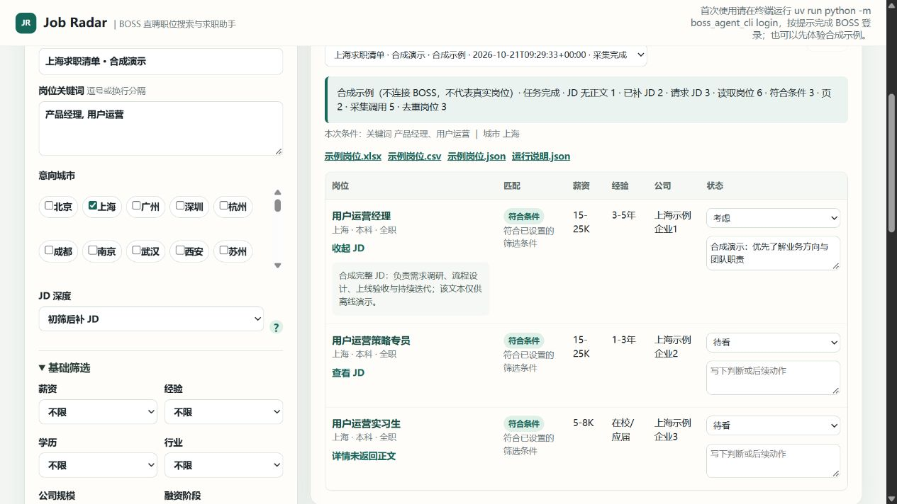

# Job Radar | BOSS Zhipin Job Search Assistant: Search, Collect, Filter, Export JDs & Track Applications

[中文说明](README.md) · [GitHub repository](https://github.com/HSLMLJL/boss-job-search) · [Windows portable download](https://github.com/HSLMLJL/boss-job-search/releases/tag/v0.2.0)

Job Radar is a local BOSS Zhipin job search tool, job scraper, JD exporter, and job application tracker for ordinary job seekers. Choose several keywords and cities, collect job listings into one application list, filter them locally, optionally try to collect full job descriptions (JDs), then export the fields you need to Excel, CSV, or JSON. Keep your own status and notes for jobs you are considering, have applied for, or are interviewing for.

**Let the tool handle the repetitive work of collecting, filtering, and organizing jobs.** Job Radar grew out of our ongoing job search, with experience screening tens of thousands of job records. We continue to use it for everyday job collection, filtering, and application-list management, and improve it through firsthand use.

The practical flow is **search jobs → collect and filter listings → optionally collect JDs → export an application list → prepare materials and apply yourself → follow up**. It works for product, operations, engineering, design, data, sales, and other job searches; AI product management is only one possible set of keywords.

Job Radar does **not** rewrite resumes, calculate AI fit scores, apply for jobs, or send messages. JDs can help you prepare materials, but that preparation remains your decision and work.

> Use your own authorized account and follow platform rules. Job Radar does not promise complete coverage of the platform or every JD.



*The screenshot uses synthetic demo data. See the [usage background, browser validation, and release test record](docs/job-radar-validation.md#english-summary).*

## Start here: Windows portable edition

For normal use, download [Job-Radar-0.2.0-Windows-x64.zip](https://github.com/HSLMLJL/boss-job-search/releases/download/v0.2.0/Job-Radar-0.2.0-Windows-x64.zip). It includes the required Python runtime and dependencies, so you do not need to install Python, uv, a terminal tool, or an AI key. You can also [preview a synthetic output CSV](examples/job-radar-sample.csv) before downloading anything.

1. Choose **Extract all** after downloading. Do not run it from the ZIP preview, and do not choose GitHub's automatically generated “Source code” ZIP.
2. Open the extracted folder and double-click `Start-Job-Radar.cmd`.
3. In the workspace, choose **先体验示例** to see synthetic jobs safely. It does not visit BOSS and needs neither login nor extension.
4. When ready for real searches, choose **连接 BOSS**. In Chrome, open `chrome://extensions`, enable Developer mode, select **Load unpacked**, and choose the `extension` folder shown by Job Radar. Log in to BOSS in that same Chrome, then refresh the connection in Job Radar.

Loading the extension and logging in are manual first-use steps. Connection ready only means that the local extension can communicate; BOSS login or a security check may still be required when you search. Your local tasks, history, notes, and exports are stored in `%LOCALAPPDATA%\Job-Radar`. Closing the browser tab does not stop the app; use **退出应用** when you are done. Other operating systems have not received equivalent validation.

For screenshots, troubleshooting, and the first real search with a small budget, read the [Windows quickstart](docs/job-radar-quickstart.md).

## Choose what to search and export

The UI is the normal way to use Job Radar. JSON is optional when you want a reusable task or want an AI assistant or script to prepare one.

| Choice | What you control | What it means |
| --- | --- | --- |
| Search | Multiple keywords and multiple cities | Job Radar runs each keyword-city combination and records the source keyword with saved jobs. |
| JD depth | `none`, `matched`, or `all` | `none` keeps listing data only. `matched` tries to collect JDs only for jobs that pass your local rules. `all` tries every collected job within the detail budget. |
| Filters | Salary, experience, education, industry, company scale/stage, job type, welfare, included/excluded terms, and missing-data handling | These rules are applied locally after list or JD collection. `matched` means a job passed these rules; it is not an AI score. |
| Limits | Pages, requests, JDs, jobs, and seconds | `pages` is the limit for each keyword-city pair. The other limits apply to the whole run. A budget limit, interruption, or unavailable detail panel can leave a JD incomplete. |
| Export | Excel (`xlsx`), CSV, JSON; chosen fields; `matched`, `all`, or `new` scope | Include such fields as title, company, city, pay, requirements, full JD, link, JD status, filter reason, source keywords, dates, status, and notes. `new` means jobs first recorded in this run. |

Keep the dedicated Chrome search tab visible while a run is in progress. Do not change its query or page by hand. A browser or extension restart retains saved data but loses the live page checkpoint; begin a new task instead of expecting the interrupted page to resume.

## What you get

| Goal | Result in Job Radar |
| --- | --- |
| Search across cities or role names | One local list of collected jobs, with source keywords, basic facts, and links |
| Compare real job requirements | Optional saved JDs, their collection status, and the local filter reason for each job |
| Prepare an application list | Excel, CSV, or JSON containing only the fields and scope you chose |
| Keep track of applications | Local statuses and notes that remain when the same job is seen again |

Use exported JDs as input for your own resume preparation. The [resume-preparation workflow](docs/job-radar-resume-workflow.md) shows a manual way to compare requirements and prepare materials without claiming that Job Radar generates a resume.

## FAQ

### Have both Chrome and Edge been tried?

Chrome is the currently recommended browser. **Microsoft Edge has also been validated in earlier firsthand use.** The installation and connection instructions currently use Chrome as the example; see the [validation record](docs/job-radar-validation.md#english-summary) for the respective coverage.

### Can it collect BOSS jobs for me?

It can search and collect listings from a BOSS page through your logged-in Chrome and local extension. You choose keywords, cities, filters, and run limits. Keep the dedicated search page visible, use your own account, and follow platform rules; this is not a claim of complete platform coverage.

### Why does collecting full JDs take longer?

Each full JD requires opening a job's detail panel, waiting for its content, and checking that it belongs to the intended job. More keywords, cities, or jobs can therefore take longer, especially with `all` JD collection. Much of the waiting happens while reading web pages; rule-based filtering, deduplication, and export run locally.

For everyday searches, `matched` collects JDs only for jobs that pass your rules, balancing detail and elapsed time. The app reads listings page by page and JDs one at a time, with request, detail, and runtime limits. It saves collected results and stops when it detects expired login or a security check; these controls do not guarantee that an account will avoid verification. Keep the app running and the dedicated Chrome search page visible. You do not need to copy each job manually.

### Does collection keep using AI model quota?

**The core workflow does not call an LLM.** Search, listing and full-JD collection, rule-based filtering, deduplication, and export are executed by the local program. No model API key is required, and collecting another job does not consume model tokens in Job Radar. Waiting for a page does not require continuous model inference.

If you separately ask an AI assistant to prepare a search configuration, check progress, or analyze exports, those AI interactions remain subject to that service's quota and pricing. The app's request, detail, and time budgets are collection limits, not paid model credits.

### Can I export Excel and JDs?

Yes. Choose `xlsx`, CSV, or JSON and select the fields to export. Full JD is optional: its collection depends on your selected `none` / `matched` / `all` depth, the detail budget, and whether the visible detail panel has usable content.

### Can an AI assistant help run a search task?

Yes. An assistant with permission to run local commands can draft keywords, filters, export fields, or a local JSON task; it can also execute the collection command and help read exported JSON. See [AI and CLI usage](docs/job-radar-agent-usage.md) for the executable local commands. The portable edition can run them too; use the guide's `--data-dir` value to share the UI's local data. Do not run a CLI collection while the UI is collecting.

### Does it apply automatically?

No. Job Radar does not automatically apply, message recruiters, bypass login or verification, rewrite resumes, or provide AI fit scores. You decide what to apply for and complete each application on BOSS.

## Developers and source installation

The portable package is the recommended Windows path. To run from source instead, download the [source ZIP](https://github.com/HSLMLJL/boss-job-search/archive/refs/heads/main.zip), install [uv](https://docs.astral.sh/uv/), and run:

```powershell
uv sync --python 3.13
uv run python -m job_radar ui
```

The [usage guide](docs/job-radar-guide.md) covers filters, budgets, exports, and recovery. Core search, filtering, tracking, and export do not need an LLM.

Built on the MIT-licensed [boss-agent-cli](https://github.com/can4hou6joeng4/boss-agent-cli), with original notices retained. [MIT License](LICENSE).
