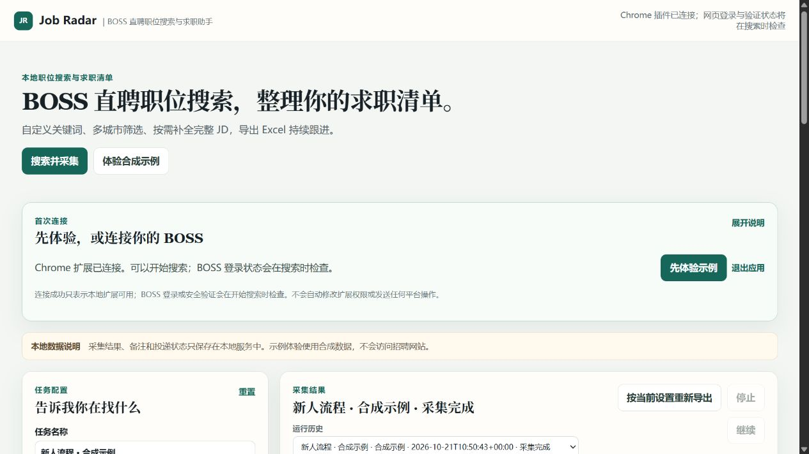

# Windows 便携包快速开始

本指南面向第一次使用 Job Radar 的求职者。v0.2.0 Windows 64 位便携包自带官方 Python 运行环境和依赖，正常使用不需要安装 Python、uv 或其他开发工具。



## 1. 下载正确的文件

从 Release 页面下载 **`Job-Radar-0.2.0-Windows-x64.zip`**：

<https://github.com/HSLMLJL/boss-job-search/releases/download/v0.2.0/Job-Radar-0.2.0-Windows-x64.zip>

不要下载 GitHub 自动生成的 **Source code (zip)**；那是给源码用户的，不是可直接启动的便携包。

## 2. 全部解压

右键下载的 ZIP，选择“全部解压缩”，再打开解压后的文件夹。确认里面至少有：

- `Start-Job-Radar.cmd`
- `runtime` 文件夹
- `extension` 文件夹

不要在 ZIP 的预览窗口内双击启动脚本；请先完整解压。

## 3. 启动并先体验示例

双击 `Start-Job-Radar.cmd`。本地工作台会在浏览器打开；若浏览器没有自动出现，可再双击一次启动脚本。

第一次先点击 **“体验合成示例”**。它不会访问 BOSS，不需要登录、加载 Chrome 扩展或提供模型密钥。你可以先查看岗位卡片、JD 状态、筛选依据和导出入口。

关闭浏览器页面不会退出 Job Radar；启动窗口仍在运行时可以再次打开页面。便携包会处理默认端口 `8766` 被占用的情况并选择可用端口；重复双击会复用正在运行的本地服务，而不会创建另一份工作区。

## 4. 在 UI 中连接 Chrome

要搜索自己的岗位，在工作台顶部的首次连接卡点击 **“连接 BOSS”**：

1. 按卡片显示的路径，在 Chrome 地址栏打开 `chrome://extensions`。
2. 开启右上角“开发者模式”。
3. 点击“加载已解压的扩展程序”，选择便携包中的 `extension` 文件夹。
4. 在同一个 Chrome 正常登录 BOSS，确认网页能打开职位列表。
5. 回到工作台，点击“刷新连接”。

连接成功只说明本地扩展已连接；登录或安全验证会在开始搜索时再检查。Job Radar 不会替你修改扩展权限、绕过验证、投递岗位或发送消息。

## 5. 用小预算做一次真实搜索

先填一个你真正考虑的岗位关键词，选择一个城市，其他筛选可以暂时留空。建议第一次使用：

| 界面选项 | 建议值 |
| --- | --- |
| JD 深度 | 初筛后补 JD |
| 缺失信息 | 保留，稍后人工判断 |
| 每组页数 | 1 |
| 采集调用数 | 4 |
| 补 JD 数 | 3 |
| 岗位数 | 5 |
| 秒数 | 180 |
| 导出格式 / 范围 | Excel / 全部岗位 |

点击 **“搜索并采集”**。保持扩展打开的专用 BOSS 搜索页可见，不要在运行中手动改搜索词或翻页。岗位数与 JD 数都是上限，不保证会返回相同数量；筛选在采集后本地应用，不能把这一轮当作平台全部岗位。

## 6. 导出、记录和退出

在结果里检查标题、公司、链接、JD 状态和筛选依据。把准备继续处理的岗位标为“考虑”，在备注写下下一步；由你在原 BOSS 页面完成投递或沟通，再手动改为“已投”或“面试”。

需要表格时，在“导出内容”选择字段和格式，点击 **“按当前设置重新导出”**。任务、岗位历史、备注和导出默认保存到：

```text
%LOCALAPPDATA%\Job-Radar
```

结束时请在首次连接卡点击 **“退出应用”**，不要只关浏览器标签页。下次仍从解压目录双击 `Start-Job-Radar.cmd`，本地历史和模板会继续保留。

## 常见问题

| 现象 | 处理方式 |
| --- | --- |
| 下载的是 Source code ZIP | 回到 Release 页面，下载名称含 `Windows-x64.zip` 的资产。 |
| 在 ZIP 预览窗口内启动失败 | 先“全部解压缩”，再从解压目录启动。 |
| 解压后缺少 `runtime`、`extension` 或启动脚本 | 删除这份不完整文件，重新下载便携包并重新解压。 |
| Chrome 未显示已加载扩展 | 在 `chrome://extensions` 检查是否选中了便携包的 `extension` 文件夹；不要选择 ZIP 文件本身。 |
| 双击后浏览器没有打开 | 再双击一次启动脚本；若仍失败，查看启动窗口的提示，并在数据目录的日志中保留脱敏报错。 |
| 搜索提示未连接或需要登录 | 确认扩展已加载、使用的是同一个 Chrome，并在 BOSS 页面完成登录或必要验证后刷新连接。 |
| 找不到历史、导出或需要排查问题 | 先检查 `%LOCALAPPDATA%\Job-Radar`；请不要公开上传其中的账号信息、备注或完整求职数据。 |

当前项目的功能和边界说明见 [README](../README.md)。如需用 AI 或脚本生成并执行本地搜索任务，见[命令与 AI 助手调用](job-radar-agent-usage.md)。

<details>
<summary>开发者：从源码运行</summary>

源码方式需要自行安装 [uv](https://docs.astral.sh/uv/)，然后在包含 `pyproject.toml` 的目录运行：

```powershell
uv sync --python 3.13
uv run python -m job_radar ui
```

源码方式不等同于 Windows 便携包；不要把 GitHub Source code ZIP 当作免安装版本。
</details>
